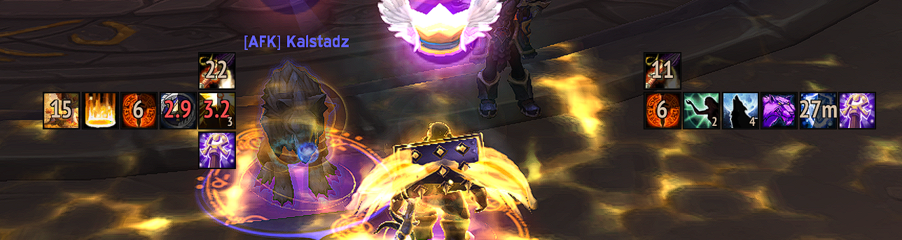

# Filger

## Description

**Filger** is a minimalistic buff/debuff tracker for **World of Warcraft**.
A single addon folder serves every supported client and should look the same on all of them.

> Filger is being revived after a long break. Most of it is still **pending in-game verification**.

<p align="center">
    
</p>

## Supported clients

| Client                | Interface |
|:----------------------|:----------|
| Retail (Midnight)     | `120105`  |
| Classic Forever       | `16001`   |
| Classic Era           | `11509`   |
| Classic TBC           | `20506`   |
| Classic WotLK (Titan) | `38002`   |
| Classic MoP           | `50504`   |

Cataclysm is not supported.

## Frames

| Frame              | Unit     | Tracks                                  |
|:-------------------|:---------|:----------------------------------------|
| `PLAYER_DEBUFFS`   | `player` | Debuffs                                 |
| `PLAYER_AURAS`     | `player` | Buffs cast by the player                |
| `PLAYER_BUFFS`     | `player` | Buffs                                   |
| `TARGET_DEBUFFS`   | `target` | Debuffs                                 |
| `TARGET_AURAS`     | `target` | Buffs                                   |
| `FOCUS_DEBUFFS`    | `focus`  | Debuffs                                 |
| `BOSS_DEBUFFS`     | `player` | Debuffs applied by bosses               |
| `PLAYER_COOLDOWNS` | `player` | Spell and item cooldowns                |

Spells shown or hidden per client are listed in [data/](./data).

> On Retail, while auras and cooldowns are restricted (secret values), only listed spells
> are tracked and timers use Blizzard's countdown numbers.

## Usage

### Commands

-   `/filger help` - List all available commands.

## Configuration

There is no in-game configuration. Frames are defined in [config.lua](./config.lua).

Please report Lua errors as [issues](https://github.com/lua-wow/Filger/issues).

## Dependencies

-   Required: none.
-   Optional: [Tainted](https://github.com/lua-wow/Tainted) or [Tukui](https://github.com/tukui-org/Tukui).
    When either is loaded, Filger uses its API instead of its own.

## Installation

1.  Download the latest version of [**Filger**](https://github.com/lua-wow/Filger/releases)
2.  Backup your **Interface** and **WTF** folders.
3.  Delete the **Cache** and **WTF** folders for a clean install.
4.  Copy the **Filger** folder into the client's AddOns folder.
    - `World of Warcraft/_retail_/Interface/AddOns`
    - `World of Warcraft/_classic_era_/Interface/AddOns`
5.  Now you're ready to launch World of Warcraft.

To install from git, clone **with submodules**: the bundled libraries in `libs/` are git
submodules, and the addon won't load without them.

## Development Setup

### Method 1

```bash
# clone the repository along with submodules
git clone --recurse-submodules git@github.com:lua-wow/Filger.git
```

### Method 2

```bash
# clone just the main repository
git clone git@github.com:lua-wow/Filger.git

# initialize/clone submodules
git submodule update --init --recursive
```

### Linting

Static analysis uses [luacheck](https://github.com/lunarmodules/luacheck), configured in [.luacheckrc](./.luacheckrc).

Requirements: **Lua 5.1**, **LuaRocks** and **luacheck** (`luarocks install luacheck`).

```bash
# list available make commands
make help

# lint the whole addon (submodules under libs/ are excluded)
make check

# lint a directory or a single file, showing warning codes
luacheck core/
luacheck Filger.lua --codes
```

When using a new WoW API function, frame or constant, add it to `read_globals` in `.luacheckrc`.
Globals the addon intentionally sets or mutates go in `globals`.

## Credits

-   Nils Ruesch, Shestak, Affli, Garagar, hidekki, FourOne and Tukz.
-   [Tukui](https://www.tukui.org) by Tukz, the visual reference.
-   [LibStub](https://www.curseforge.com/wow/addons/libstub) by Kaelten.

## License

Please, see [LICENSE](./LICENSE) file.
